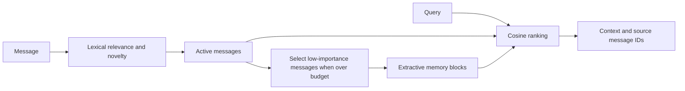

# Shard

**A model-free experiment in conversational context compression and retrieval.**

Shard keeps recent messages in an active window and moves selected messages into an
extractive archive. Deterministic hashed word vectors make the experiment runnable
without provider credentials or model downloads.

## Quick start

Requires Python 3.10 or newer. Dependency installation requires internet access.

```sh
python3 -m venv .venv
source .venv/bin/activate
python -m pip install -r requirements.txt
python demo.py
```

```python
from shard_core import ShardCore

memory = ShardCore(max_active_tokens=300, block_size=4)
memory.add_message("The deployment uses a single API worker.", role="user")
memory.add_message("Keep the index directory on persistent storage.", role="assistant")
print(memory.get_context_for_model(query="How is the service deployed?"))
print(memory.get_metrics())
```

## Capacity check

With a 300-token active budget and blocks of four, inserting 1,000 messages of the form `Observation {i}: the search index is stored on persistent disk.` (i = 0…999) retained 20 active messages and 245 archive blocks. Shard estimated 300 active tokens and 4,410 archive tokens from 15,000 input tokens. Repeated wording makes this a storage check rather than a semantic recall benchmark.

## Verification

```sh
python -m unittest discover -s tests -v
python test_scenarios.py
python comprehensive_analysis.py
# Runs the demo, scenario checks, and analysis sequentially:
python run_all.py
```

Analysis writes generated artifacts under `output/`. The scenario suite uses authored
conversations and a synthetic 1,000-message workload. Timing depends on the machine;
these checks do not establish semantic recall or superiority over other memory systems.

## Design



The core uses 384-dimensional signed feature hashing, approximate character-based token
counts, entropy-based novelty, and temporal decay. Compression keeps selected message
text; it does not call a summarization model. Hash collisions and lexical mismatch can
affect retrieval. Archive embeddings represent the retained summary text.
Retrieval omits zero or negative cosine matches; a query with no matching
hashed features returns no result. Hash collisions can still produce false matches.

Call `delete_message(msg_id)` to remove a stored message. When its text may be part of an
archive block, Shard removes the entire block so the deleted content cannot reappear in
retrieval. Other messages represented only by that block are lost too. The cumulative
`total_messages` and `raw_tokens` metrics still describe ingestion history.

## Repository guide

| Path | Purpose |
|---|---|
| `shard_core.py` | Message storage, scoring, archive construction, retrieval |
| `demo.py` | Small conversational walkthrough |
| `test_scenarios.py` | Scenario checks with failing process status |
| `tests/` | Regression coverage for runner behavior, memory budgets, provenance, context limits, and input validation |
| `comprehensive_analysis.py` | Synthetic analysis and figures |
| `run_all.py` | Sequential script runner |

## Scope

The active window stays within the configured approximate token budget. The archive keeps the most recent 256 blocks by default. Old blocks are evicted, so the archive can lose information. Set `max_tokens` on `get_context_for_model` to cap the returned text at four characters per estimated token. Use a model tokenizer when an exact token count matters.

## License

[MIT License](LICENSE) for the project code. Third-party software, models, and datasets retain their own terms.
